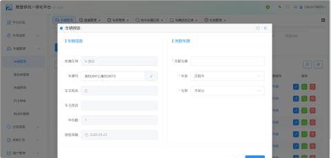
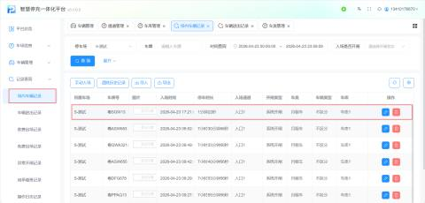
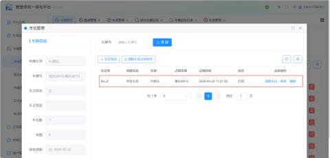
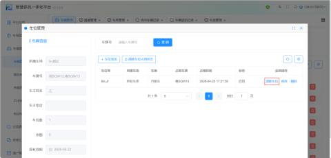
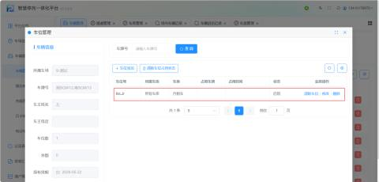
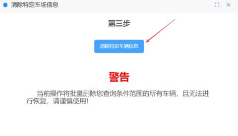
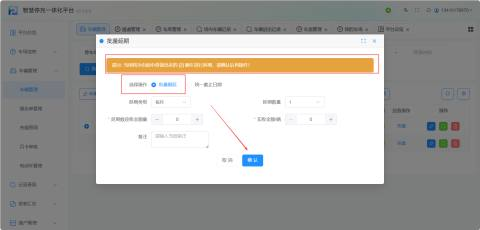
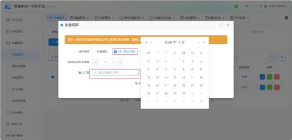

#### **1、清**此功能专门针对**一户多车**且**共用车位**的场景。当关联车牌的车辆进场时，系统会自动占用固定车位，若需释放该车位供其他关联车辆使用，需执行此操作。
+ **适用场景**：车辆A（关联车牌）进场占用了车位X，现在车辆B（同户关联车牌）也要进场，需先清除车辆A对车位X的占用状态。
+ **操作路径**：
    1. 进入【车辆管理】列表，找到对应的关联车辆（如文档中的“粤SQW13”）。
    2. 点击【管理车位】或【清除车位占用状态】按钮。
    3. 在弹窗或车位列表中，点击【清除车位】。
+ **结果**：该车辆对车位的占用记录被解除，车位状态变为空闲，可供同户其他车辆重新分配或停放。

该车进场的记录：

占用的车位：

当需要清除车位占用的时候，点击【清除车位占用状态】即可：

此时该车为已经被清除成功，该车位即可继续停车了

**2****、批量删除****：**用于清理系统中不再需要的车辆信息，操作不可逆，需谨慎使用。

+ **风险提示**：**删除后数据无法恢复**。系统强制要求在删除前必须先导出数据。

因为考虑到有些车辆信息对客户的重要性，我们系统也做了”车辆信息的导出“，用户在删除前可以先把车辆信息导出的操作，因为删除是无法进行恢复，所以讲车辆信息导出可以以防后期用户需要查询信息。点击【车辆信息导出】即可

车辆信息导出完成后，点击【清除特定车辆信息】确认之后点击【确定】即可

批量删除之后 所有车辆信息就被清空

**3、批量延期--批量顺延**

支持为多辆月租车集中办理续费（延期），支持两种计算模式：**“批量顺延”**和**“统一截止日期”**

| 1 | 延期类型 | 按天/按月/按季/按年  举例：选中按月，就是按月延期 |
| --- | --- | --- |
| 2 | 延期数量 | 输入延期的数量 举例：选1，寄延期为1个月 |
| 3 | 应收金额/辆 | 每辆车应收的金额（与第4相关联） |
| 4 | 实收金额/辆 | 每辆车应收的金额是多少实收就是多少，也可根据所需进行修改（与第3相关联） |
| 5 | 备注 | 输入充值备注 |

**批量延期--统一截止日期**

| 1 | 应收金额/辆 | 每辆车应收的金额（与第2相关联） |
| --- | --- | --- |
| 2 | 实收金额/辆 | 每辆车应收的金额（与第1相关联） |
| 3 | 统一截止日期 | 选好车辆统一截止的日期（必填） |
| 4 | 备注 | 输入充值备注（选填） |

