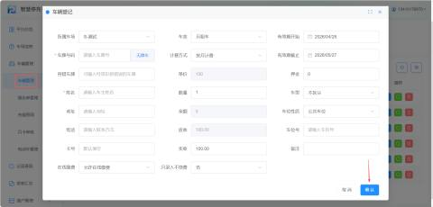
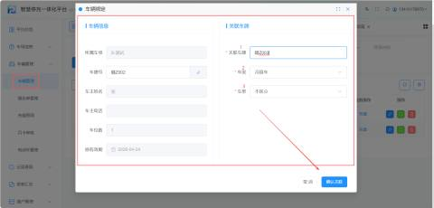
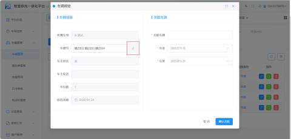
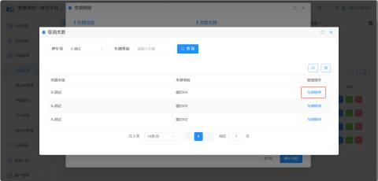
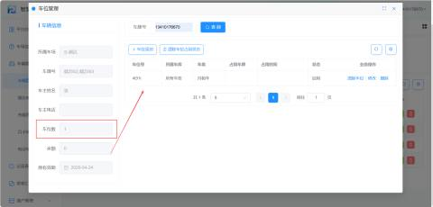
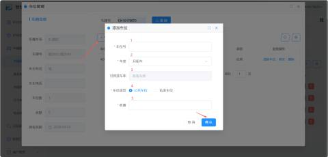

**1、**这是将车辆引入系统的第一步，主要用于录入月租车或储值车的基本档案。

+ **操作路径**：【车辆管理】 -> 【车辆管理】 -> 【车辆登记】

| 1 | 所属车场 | 默认当前车场 |
| --- | --- | --- |
| 2 | 车类 | 下拉框，车主自行选择 注意：车类的类型需要先在车场信息的车类管理进行添加 |
| 3 | 有效期开始 | 当天加入当天开始，用户也可根据所需进行选择时间 注意：当车类选择储值车时，储值车是没有有效期的 |
| 4 | 车牌号码 | 输入车主的车牌号码（必填） |
| 5 | 计算方式 | 下拉框，按日计费/按月计费/按季计费/按年计费 举例：若选择按月计费，则代表该车按月计费停车 |
| 6 | 有效期截至 | 有效期截至 |
| 7 | 容错车牌 | 输入容错车牌（选填） |
| 8 | 押金 | 输入押金的金额（选填） |
| 9 | 姓名 | 输入车主姓名（必填） |
| 10 | 数量 | 时间的额度（与第10、17、18配合） 举例：输入2，代表2个月，有效期当天开始，时间额度为2个月 |
| 11 | 车型 | 默认选择“不区分” 注意：在”车场信息--车型管理”查看，未启用的车型，此处就选不了 |
| 12 | 地址 | 输入地址（选填） |
| 13 | 车位性质 | 公共车位、私家车位 |
| 14 | 电话 | 车主电话（选填） |
| 15 | 车位号 | 选填 |
| 16 | 卡号 | 车位编号（选填） |
| 17 | 备注 | 选填 |
| 18 | 在线缴费 | 允许/不允许在线缴费 |
| 19 | 只录入不续费 | 当选择是时，单价设置不了 |

**2、车牌关联：**

该功能用于解决“一户多车”共用一个车位或月租额度的场景，即主车牌之外，增加副车牌的通行权限。

首先选中车类再点击【车牌关联】，最后再弹出的窗口填入要关联的车牌号选择好车类和车型，最后点击【确认关联】

| 1 | 关联车牌 | 填入要关联的车牌号 |
| --- | --- | --- |
| 2 | 车类 | 选择关联车牌号车的车类 |
| 3 | 车型 | 选择关联车牌号车的车型 |

注意：按临时车或储值车计费时不可进行车牌关联的操作

关联好可以重新点击【车牌关联】进行查看，若需要取消关联，可以点击红色取消绑定的图标，最后点击【车牌解绑】即可。

**3、管理车位：**

针对已登记或已关联的车辆，进行具体的车位分配和占用状态管理。

+ **操作路径**：选中车辆 -> 点击【管理车位】

进行关联后的车牌若需要添加车位，可点击【车位添加】

| 1 | 车位号 | 根据所需输入车位号 |
| --- | --- | --- |
| 2 | 计费类型 | 计费类型与平台同步 |
| 3 | 可停放车库 | 默认所有车库 |
| 4 | 车位类型 | 公共车位、私家车位二选一 |
| 5 | 收费 | 添加车位的收费（必填） |

