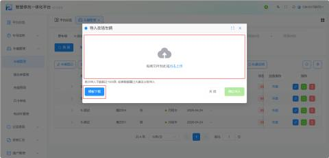
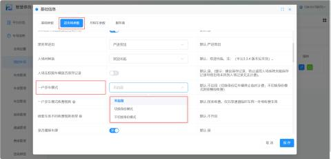
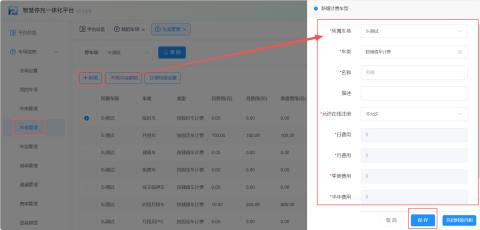
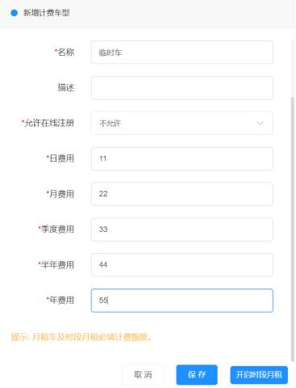
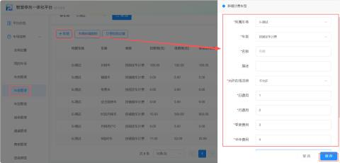
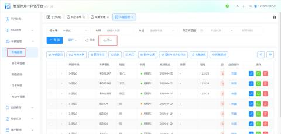
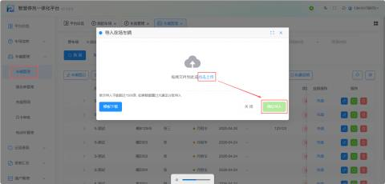
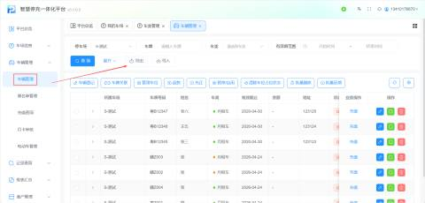
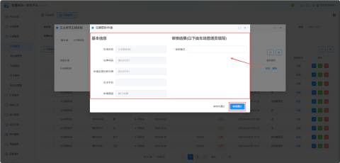

1. 前置基础配置  
在正式导入数据前，必须先完成系统参数的开启设置，否则可能导致导入失败或功能异常。

**       开启“一户多车”模式**：

+ **路径**：【全局设置】 -> 【基本参数】 -> 找到【一户多车模式】。

| 1 | 所属停车场 | 填入所属的停车场名称 |
| --- | --- | --- |
| 2 | 姓名 | 输入车主姓名（注意：名字相同的车主会进行自动关联车牌） |
| 3 | 车牌号码 | 车牌填写（注意：车牌号用逗号【,】或者竖杠【|】隔开会自动关联） |
| 4 | 电话 | 输入车主电话 |
| 5 | 地址 | 输入地址，选填 |
| 6 | 车型 | 输入车型， |
| 7 | 计费车型 | 用户在模板填入计费车型导入系统应跟计费车型一致，月租车/储值车两种类型 举例：张三，“粤E12118”，此车辆填写储值车，导入车辆到系统平台，就是储值车 |
| 8 | 可停放车库 | 根据现场需求进行设置，选填 举例：此车场车库有4个，可以进行自主分配，也可不限车库，那就是哪个车库都可停放 |
| 9 | 开始日期 | 根据现场需求进行设置，必填   举例：当天日期为2024-10-15则当天有效，若开始日期是2024-10-15，从此天开始，状态显示正常；若导入模板填写2024-10-16，则状态显示未生效 |
|  |  | 注意：储值车没有有效期，特殊情况开启时段月租车的储值就有有效期； |
| 10 | 结束日期 | 有效期止，根据现场需求进行设置，必填 举例：若开始日期为2024-8-15，结束日期为2024-9-15，那么此车状态就会显示过期 |
| 11 | 金额 | 根据现场需求进行设置，选填 |
| 12 | 押金 | 根据现场需求进行设置，选填 |
| 13 | 车位数 | 根据现场需求进行设置，必填 举例：当姓名相同的车牌号会自动关联。注意车位数的填写：如该关联车只有1个车位时，填入的车位数为1；以此类推。 |
| 14 | 车位性质 | 根据现场需求进行设置，选填 |
| 15 | 备注 | 根据现场需求进行设置，选填 |
| 16 | 操作员 | 根据现场需求进行设置，选填 |
| 17 | 卡号 | 根据现场需求进行设置，选填 举例：车位编号，有些停车场车位编号是为了标识和区分停车场内的每一个车位，通常由一组数字、字母或其他符号组成。 |

导入登记车时请先开启一位多车模式，依次点击：车辆信息(左侧列表)--我的车场--基本参数

找到一户多车模式将其启用（建议客户都选择“新的一户多车模式”），默认是不开启，也可根据所需选择切换计费/不切换计费。一户多车的切换计费是指在一个车位上，多辆车需要共享这个车位，并且这些车辆的使用会按照一定的规则进行计费。‌

切换计费就是比如一车位两辆车，当A车入场时为固定车，B车入场时按临时车计费，当A车出场后，B车停止计费。

不切换计费就是比如一个车位两辆车，当A车入场时为固定车，B车入场时按临时车计费，当A车出场后，B车继续计费。B车出场时计算B车入场的时间至B车出场时间的整段费用。

注意：在填写导入模板--计费车型之前，用户需要在车类管理添加所需的计费类型，否则无法导入

点击右上角【新增车辆】，车类类型一共分按储值车收费、按固定车收费。

①按储值车收费：按储值车收费则是通过预存一定金额作为停车费用，根据停车时长或次数扣除相应费用。

| 1 | 所属车场 | 默认当前车场 |
| --- | --- | --- |
| 2 | 车类 | 按储值车计费/按固定车收费   举例：此处选按储值车计费 |
| 3 | 名称 | 输入计费车型名称 举例：临时车收费 |
| 4 | 描述 | 用户根据所需进行填写，选填 |
| 5 | 允许在线注册 | 允许在线注册就是线上申请月租车,就是申请的时候可以选择这个车类 |
| 6 | 日费用 | 选择按储值车计费，按费率计费，日费无需设置，此处设置不了 |
| 7 | 月费用 | 选择按储值车计费，按费率计费，月费无需设置，此处设置不了 |
| 8 | 季度费用 | 选择按储值车计费，按费率计费，季度费无需设置，此处设置不了 |
| 9 | 半年费用 | 选择按储值车计费，按费率计费，半年费无需设置，此处设置不了 |
| 10 | 年费用 | 选择按储值车计费，按费率计费，年费无需设置，此处设置不了 |

提示:  月租车及时段月租必填计费额度。如图所示：当开启时段月租，用户必须填写计费额度  
注意：按储值车计费是没有有效期，但是有一种特殊情况就是开启时段月租，这种情况是有有效期的，时段月租车就是比如某个车场在白天8：00-20：00（临时车的类型），在夜晚20：00-8：00（月卡车的类型），这种特殊情况的储值车就是有有效期的。

②按固定车收费：按固定车收费通常是指车辆拥有固定的停车位或停车费用，这类车辆通常享有长期租赁或购买车位的服务。

| 1 | 所属车场 | 默认当前车场 |
| --- | --- | --- |
| 2 | 车类 | 按储值车计费/按固定车收费   举例：此处选按固定车收费 |
| 3 | 名称 | 输入计费车型名称 举例：地库月租车 |
| 4 | 描述 | 用户根据所需进行填写，选填 |
| 5 | 允许在线注册 | 允许在线注册就是线上申请月租车,就是申请的时候可以选择这个车类，客户自行选择设置 |
| 6 | 可停放车库 | 是指车主通过支付一定的费用，获得在特定车库中停放车辆的权限。 举例：此处选择不限车库，那么车主可以自主选择车库进行停放车辆 |
| 7 | 日费用 | 按照每天的费用标准对车辆进行收费   举例：此处设置为1，某个停车场可能会对停车费用按照每天1元的标准进行收费，无论车辆停放时间多长，每天的费用都是1元‌ |
| 8 | 月费用 | 车主按月支付固定的停车费用，该月内车辆可以无限次进出停车场，不限制停车时长。 举例：此处设置为2，某个停车场可能会对停车费用按照每月2元的标准进行收费，该月内车辆可以无限次进出停车场，不限制停车时长 |
| 9 | 季度费用 | 是指按照季度收取的停车费用   举例：按固定车收费季度费用意味着车辆所有者需要一次性支付三个月的停车费用，而不是按月支付 |
| 10 | 半年费用 | 按固定车收费半年费用是指按照车辆的类型和规定的收费标准，在半年内需要支付的费用。 举例：按固定车收费季度费用意味着车辆所有者需要半年的停车费用 |
| 11 | 年费用 | ‌按固定车收费年费用是指车主每年需要支付给停车场的固定费用。 |

将一户多车模式开启完毕，车类管理设置完成，导入模板信息填写完整，客户将模板导入最后点击【确定】按钮就可以实现导入车辆信息的操作

**导出**

若需要对车辆信息进行导出，可以点击【车辆导出】按钮，在下载列表点击查看即可。

**车主修改车牌审核：**

导入数据后，若车主在小程序端申请修改车牌，管理员需在后台进行审核。

+ **车主端操作**：
    1. 进入【壹家社区】小程序 -> 【月卡充值】 -> 找到车辆 -> 点击【车牌更换】。
    2. 填写新旧车牌号及申请原因 -> 点击【确认办理】。

搜索到自己的车之后点击**【车牌更换】：**

将新的车牌号和申请原因填写完整后点击**【确认办理】：**

**车场方可在平台系统进行查看申请，依次点击车辆管理--车辆管理--车主修改车牌审核**

**收到车主申请修改车牌，审核之后点击审核通过即可**

