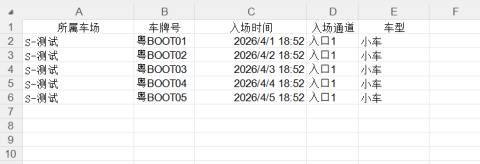

1、在填写导入模板前，必须先确认车场的**通道名称**，这是导入成功的关键。

+ **操作路径**：【车场信息】 -> **【通道管理】**。

+ **关键点**：模板中填写的“入场通道”必须与系统中设置的**通道名称完全一致**（如“入口1”），否则系统无法识别，导致导入失败。

将下载好的模板进行填写信息

| 1 | 所属停车场 | 填入所属的停车场名称   举例：若我的车场名字是测试，那么模板里就填写测试 |
| --- | --- | --- |
| 2 | 车牌号码 | 车牌填写（必填） 举例：“粤S12345” |
| 3 | 入场时间 | 时间填写，就是车辆入场的时间（必填）   举例：可以写任何时间，如“2024-10-12” |
| 4 | 入场通道 | 填写车场的入场通道（注意：入场通道必须和平台上车场的通道名称一致） 举例：车场的入口名字为“入口1”，那模板导入就应填“入口1” |
| 5 | 车型 | 根据现场需求进行设置，选填 |

#### **2、执行导入与数据校验**
+ **上传文件**：
    1. 回到【场内车辆记录】页面，点击【导入】。
    2. 将填写好的Excel文件**拖拽**到指定区域或点击上传。
    3. 系统会显示“当前上传数量:X条”。
+ **限制提示**：单次导入数据量**不能超过 1500 条**。若数据量过大，建议分批进行导入。
+ **确认入库**：核对预览数据无误后，点击【确认导入】。

导入文件后，此窗口也会展示用户导入的数据的数量，用户确认之后进行点击【确认导入】即可：

导入成功后，页面展示我们的导入的车辆，用户可以进行查询，校验车辆：

若导入的车辆，用户需要修改车辆的相关信息，点击【修改】图标，进行编辑信息：

举例：将粤BOOT1修改为湘BOOT1，最后点击【确定】即可，如图所示：

| 1 | 车牌 | 修改车牌号，一般情况下就是车牌号有无才需要进行修改 |
| --- | --- | --- |
| 2 | 通道 | 不修改 |
| 3 | 车辆类型 | 不修改 |

修改完成后进行查看：将粤BOOT1修改为湘BOOT1：

若需要对在场车辆进行删除，点击【删除】即可：

