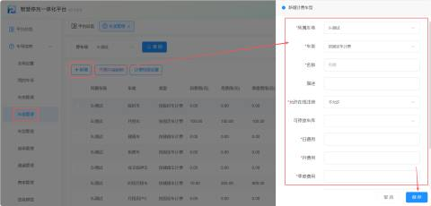
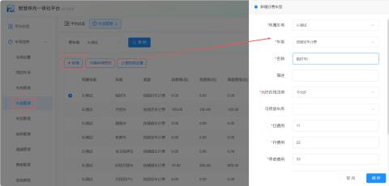
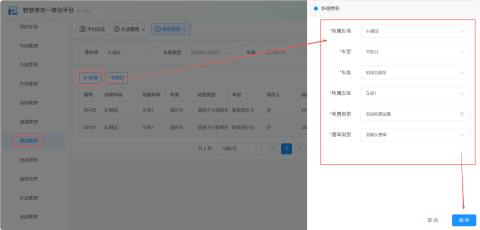
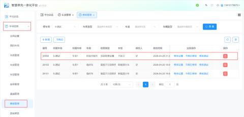

+ **计费方式锁定**：时段月租车设置**只能按储值车收费**。

**①按储值车收费：****按储值车收费则是通过预存一定金额作为停车费用，根据停车时长或次数扣除相应费用。**

| 1 | 所属车场 | 默认当前车场 |
| --- | --- | --- |
| 2 | 车类 | 按储值车计费   时段月租车设置只能按储值车收费 |
| 3 | 名称 | 输入计费车型名称 举例：分时段月租车 |
| 4 | 描述 | 用户根据所需进行填写 |
| 5 | 允许在线注册 | 允许在线注册就是线上申请月租车,就是申请的时候可以选择这个车类 |
| 6 | 可停放车库 |  用户可自主选择指定可停车库 / 分区，系统根据所选车库，匹配对应空余车位，避免跨区乱停、错库停放，规范车辆停放范围。   |
| 7 | 日费用 | 选择按储值车计费，按费率计费，日费无需设置，此处设置不了 |
| 8 | 月费用 | 选择按储值车计费，按费率计费，月费无需设置，此处设置不了 |
| 9 | 季度费用 | 选择按储值车计费，按费率计费，季度费无需设置，此处设置不了 |
| 10 | 半年费用 | 选择按储值车计费，按费率计费，半年费无需设置，此处设置不了 |
| 11 | 年费用 | 选择按储值车计费，按费率计费，年费无需设置，此处设置不了 |

**提示:  月租车及时段月租必填计费额度。如图所示：当开启时段月租，用户必须填写计费额度**

**注意：按储值车计费是没有有效期，但是有一种特殊情况就是开启时段月租，这种情况是有有效期的，时段月租车就是比如某个车场在白天8：00-20：00（临时车的类型），在夜晚20：00-8：00（月卡车的类型），这种特殊情况的储值车就是有有效期的。**

开启时段月租完成后，需要增加特定的费率设置。点击车辆信息--费率管理--新增

| 1 | 所属车场 | 默认当前车场 |
| --- | --- | --- |
| 2 | 车型 | 默认不区分车型   用户也可根据现场所需进行选中 |
| 3 | 计费类型 | 选择时段月租车 |
| 4 | 所属车库 | 用户根据所需进行选择，（该车场所拥有的车库） |
| 5 | 收费类型 | 选择多段收费设置 |
| 6 | 默认费率 | 选择非默认费率 |

新增完时段月租车的特定费率，依次点击--车场信息--费率管理；找到【时段月租车】进行费率设置

**注意：用于在不同时间段内设置不同的收费标准，通常包括日间和夜间，也可以扩展至最多四个时段，如早晨、白天、晚间和夜间，或按高峰和非高峰时段区分。收费类型可分为工作日和非工作日，最大收费类型包括无最大收费、按24小时封顶、或节假日兼容封顶。可设定一天内车辆多次进出和跨段的收费限额。跨段时可选择是否有免费时间、基本计费、或补时规则， 跨天时按各自时段规则计费。起步时段和循环收费周期用于控制初次和后续收费。**

**回显字段是指在计算机程序中，将用户输入的内容原样返回给用户的功能**

| 1 | 收费类型 | 多段设置收费，用于设定不同时间段内的不同收费标准。（默认启用两个时间段，常见的设置包括日间和夜间两个时段，也可以根据需求增加至最多4个不同的时段，如早晨、白天、晚间、夜间 ，或是高峰时段和非高峰时段的不同收费标准  ）    |
| --- | --- | --- |
| 2 | 所属车库 | 回显字段 |
| 3 | 计费类型 | 回显字段 |
| 4 | 车型 | 回显字段 |
| 5 | 收费类型 | 两种类型：工作日/非工作日 |
| 6 | 最大收费类型 | 三种类型： 1. 无最大收费 2. 按24小时（兼容节假日） 3. 按24小时 |
| 7 | 当日最大收费 | 默认为0（0代表不限额） |
| 8 | 一天多次最大收费 | 默认为0（0代表不限额），一天（24小时）内车辆多次进出停车场的累计最高收费标准   |
| 9 | 跨度段是否有免费时间 | 表示车辆在跨越不同收费时段时，是否有免费停放时间 |
| 10 | 跨度段是否有基本计费 | 表示车辆在跨越不同收费时段时，是否按起步时段计费费用 |
| 11 | 跨度段是否补时 | 表示车辆在跨越不同收费时段时，是否按起步时段计费费用 |
| 12 | 跨天是否按段计费 | 表示车辆跨越一天的时间段时，是否按照各自时间段的收费规则分别计费 |
| 13 | 起始时间 | 分时段的起始时间 |
| 14 | 结束时间 | 分时段的结束时间 |
| 15 | 免费时间 | 免费停车不收费的时间 |
| 16 | 起步时段 | 如30分钟免费，从30-60分钟这段区间的收费，车主自行设置 |
| 17 | 起步循环 | 起步时段循环 (无多个循环段请勿使用) |
| 18 | 循环时段 | 如每60分钟的收费 |
| 19 | 时段限额 | 根据所需设置，设置为0的话是不限额 |

