+ **路径**：【车场信息】 -> **【我的车场】** -> **【消息接收人】**。

     进行二维码扫码关注绑定消息接收人

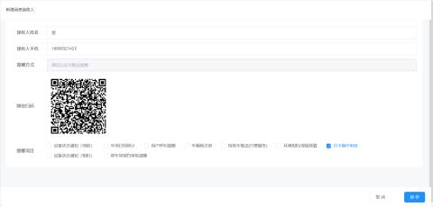

| 1 | 接收人姓名 | 输入接收人姓名 |
| --- | --- | --- |
| 2 | 接收人手机 | 输入接收人手机号码 |
| 3 | 提醒项目 | 勾选“车辆预注册”“月卡操作审核” |

（2）消息接收人绑定完毕之后，依次点击--通道二维码--场内码

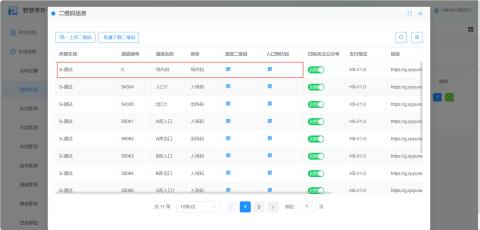

**注意：在车类的设置中只有允许这类车辆在线注册，车主才能进行线上申请月卡**

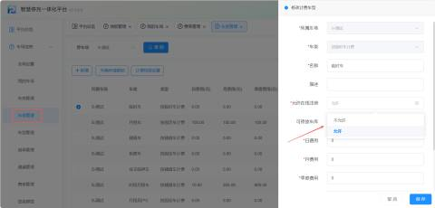

**（4）进行扫码**

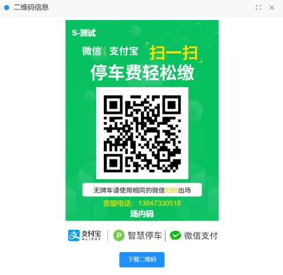

（5）扫码进入此页面，点击**【月卡车申请】**

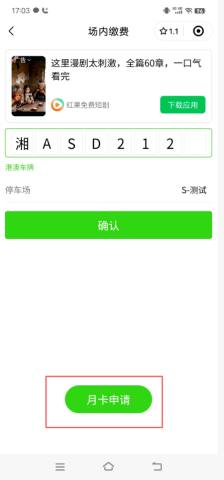

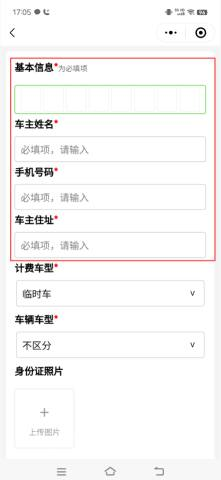

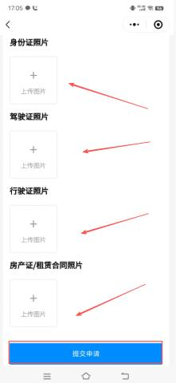

| 车牌 | 输入要是申请月卡的车牌号 举例：“甘ASD212”此车辆要申请月卡 |
| --- | --- |
| 添加车牌 | 用户在输入车牌后可以点击添加车牌后会自动加入到车牌列表中 |
| 车场名称 | 默认当前该车所属的车场 |
| 车主姓名 | 车主输入姓名，（必填） |
| 手机号码 | 车主输入手机号码，（必填） |
| 车主地址 | 车主地址，选填 |
| 计费类型 | 下拉框，根据需求进行设置，（必填）  举例：此处选择“月租车” |
| 车型 | 下拉框，根据需求进行设置，（必填） 举例：此处选择“不区分” |
| 身份证 | 根据现场需求进行设置，选填   客户可以点击“+”上传身份证图片 |
| 驾驶证 | 根据现场需求进行设置，选填 客户可以点击“+”上传身份证图片 |
| 行驶证 | 根据现场需求进行设置，选填 客户可以点击“+”上传行驶证证图片 |
| 房产证/租赁合同 | 根据现场需求进行设置，选填 客户可以点击“+”上传房产证/租赁合同图片 |

车主提交后，流程流转至管理端，需人工介入完成最终确认。

+ **接收通知**：绑定的消息接收人会收到微信推送提醒（需扫码关注公众号绑定）。

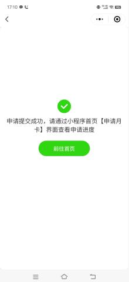

消息接收人接收到车主**“月租车线上申请”**

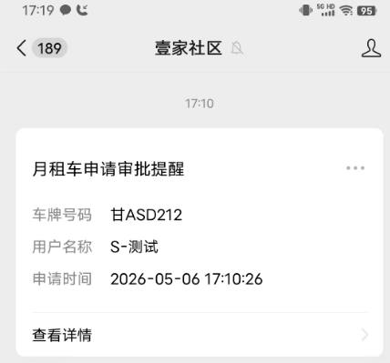

消息接收人检查完毕点击**【审核通过】**

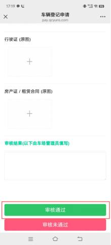

**车主审核通过可以再月卡申请记录查看**

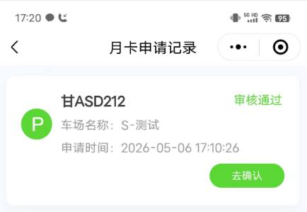

进行月租申请确认后点击**【缴月租费】**

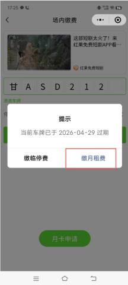

最后进行支付即可

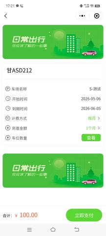

操作完毕可在平台进行查看，依次点击**--车辆管理--月卡审核**

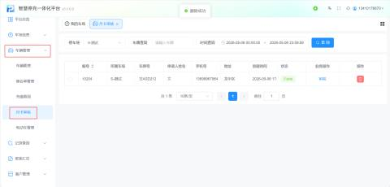

（6）车主可以在**【壹家社区】**小程序进行申请月卡，进入小程序，点击**【申请月卡】**

车主选择在当属的车场后点击**【月卡申请】：**

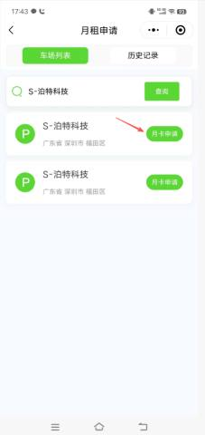

车主进行填写资料，最后点击**【确认办理】即可**

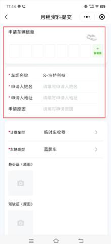

补充完信息后点击**【确认办理】**

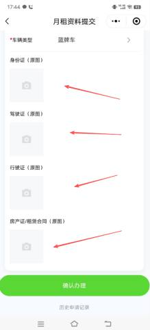

申请后等待审核：

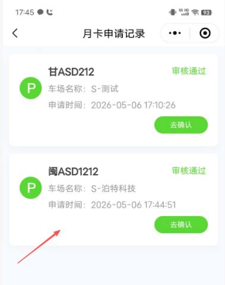

平台接收到车主申请，点击**【审核】**进行检查,，点击**【审核】**按钮**：**

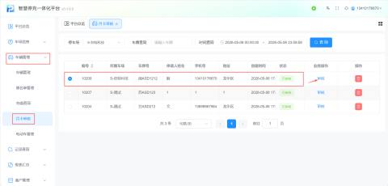

点击**【审核通过】**即可**：**

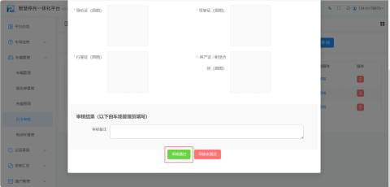

