没有车牌的车辆可以通过以下几种方案进入停车场，一共有三种模式：不限制模式，识别模式，地感模式

**一、不限制模式：**不限制，就是没什么限制，直接扫入场码，点我要入场即可，不限制模式在无车辆的情况下也可进行扫码。

**登录停车平台，依次点击：**车场信息(左侧列表)--我的车场--基本参数--无牌车扫码模式--不限制模式

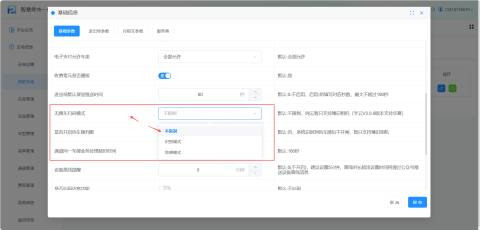

**登录停车平台，依次点击：**车场信息(左侧列表)--我的车场--通道二维码

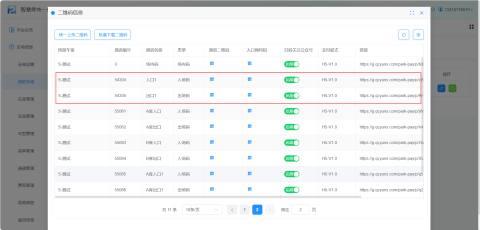

**选择相对应通道的入场码：**进行扫码，也可以进行下载二维码（点击下方“下载二维码”即可）**  
****（1）无牌车扫码入场：**扫码入场，点击【我要入场】

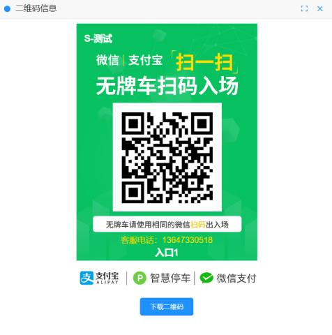

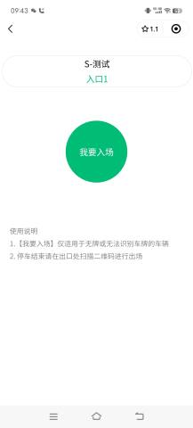

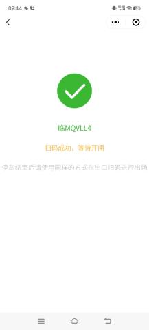

| 我要入场 | 仅适用于无牌或无法识别车牌的车辆 |
| --- | --- |
| 当无牌车辆要出场时 | 停车结束后请使用同样的方式在出口扫码进行出场 |

**可以在记录查询--场内车辆记录，后台会显示这辆“临MQVLL4”，入场：**

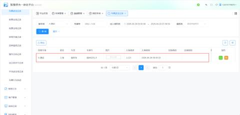

**（2）无牌车出口付款码出场：**（微信支付和支付宝支付都可以）

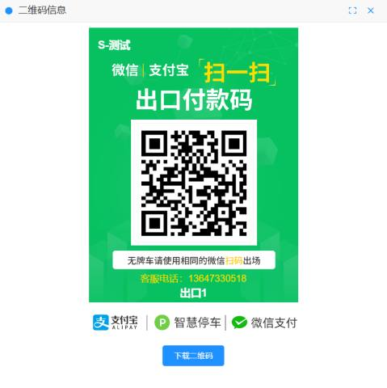

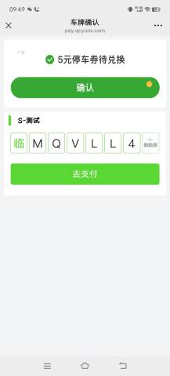

**无牌车扫码付款即可出场**

**二、识别模式：**相机通过动态运动目标识别检测车道上的车辆移动状况。当车辆通过时，相机自动捕捉车辆图像并识别车牌，进行后续处理。

**登录停车平台，依次点击：**车场信息(左侧列表)--我的车场--基本参数--无牌车扫码模式--识别模式

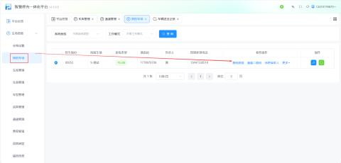

**注意：当开启识别模式的时候，相机检只有测到有无牌车，才能进行扫码入场。（无牌车进场扫码之后输入车牌，出场扫码后缴费即可）**

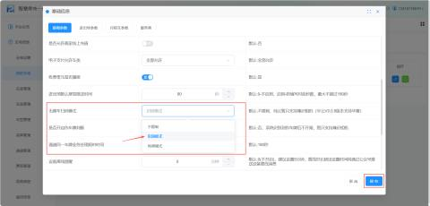

**登录停车平台，依次点击：**车场信息(左侧列表)--我的车场--基本参数--无牌车扫码模式--地感模式

**注意：当开启地感模式的时候，需要在现场装置地感，地感检测到有车辆时，进行扫码入场。（无牌车进场扫码之后输入车牌，出场扫码后缴费即可）**

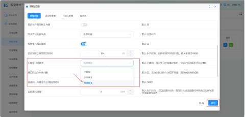

