### 接入个人微信消息推送
#### **步骤一：在相机中配置启用滞留事件**  
**点击高级设置→识别设置模块→选择车辆检测**
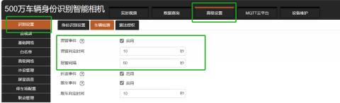

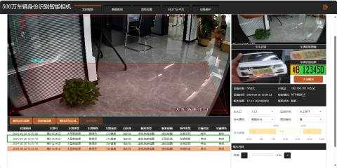

#### 步骤二:在停车管理平台设置消息接收人
1. **新建消息接收人**：  
在“消息接收人”页面，寻找并点击“新建消息接收人”按钮（或类似命名的按钮），以便为新的接收者创建一个配置项。

注：也可以在原有的信息接收人“**勾选环境相机/车辆滞留预警**”，并且无需再扫码绑定。

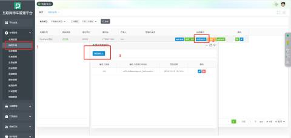

2. **勾选环境相机/车辆滞留预警**：  
在新建接收人界面，您会看到一系列可配置的选项。找到“**环境相机/车辆滞留预警**”选项，并勾选它。这意味着您希望为与车辆相关的通知设置此接收人。
3. **微信扫码绑定**：  
接下来，系统会提供一个二维码。使用您想接收通知的微信账号扫描此二维码。这一步是将车场平台与您的微信个人账号关联起来的关键步骤，确保通知能准确送达。
4. **保存设置**：  
完成微信扫码绑定后，不要忘记点击“保存”按钮，以确保所有设置被正确记录并生效。

#### 我的车场-->消息接受人-->增加接收人

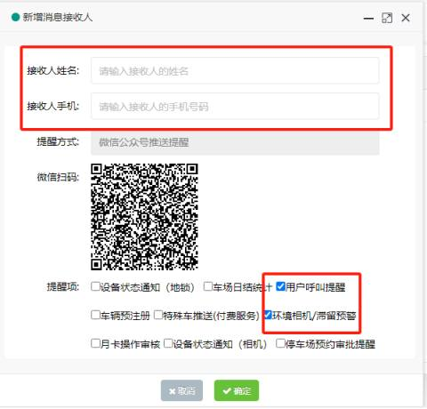

#### 打开微信扫码，进入如下页面点击确认授权即可绑定微信

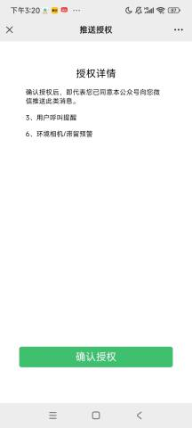

#### 报警消息推送效果展示如下图
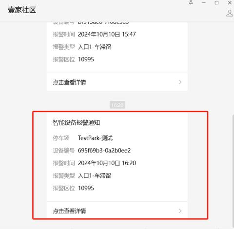

:::tips
注：值守平台报警呼叫消息推送和个人微信消息推送都会推送到壹家社区微信公众号

:::

### **接入云值守平台**
#### **车辆滞留呼叫接入云值守平台是针对车场在已开通云值守平台的前提下，无人值守的时候车辆正常操作识别入场或正常识别出场时不抬杆情况。这是如果在相机开启滞留事件检测功能就可以把车辆滞留的情况发送到云值守上。这样可实现远程处理车辆滞留事件。**
#### **步骤一：在相机中配置启用滞留事件**  
**点击高级设置→识别设置模块→选择车辆检测**

| 1    | 滞留事件    | 启用    |
| --- | --- | --- |
| 2    | 滞留判定时间    | 默认是60秒，可根据现场情况具体设置   滞留时间是指车辆在正常识别后停留在通道口的时间设置成多久才会判定车辆滞留 |
| 3    | 报警间隔    | 默认是60秒，可根据现场情况具体设置   每次报警提示间隔的时间 |

#### 停车平台车辆滞留记录如下图：
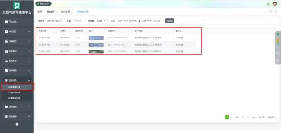

#### 步骤二：接入值守平台
车场信息配置-->报警权限-->车滞留

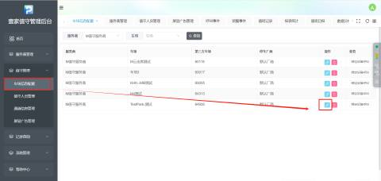

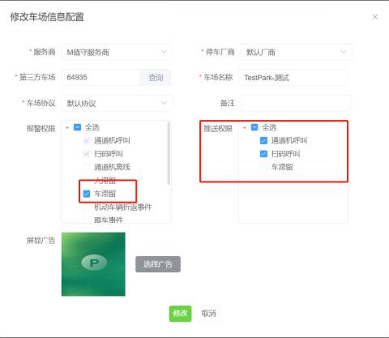

| 1 |  停车厂商 | 泊特（默认） |
| --- | --- | --- |
| 2 | 第三方车场 | 泊特云平台车场管理页面中的“车场编号” |
| 3 | 车场类型 | 默认协议和第三方协议，默认选择“默认协议” |
| 4 | 报警权限 | 可设置不同的报警类型 配置车辆滞留呼叫要勾选“车滞留”报警权限 |
| 5 | 屏显广告 | 开启/关闭 |

#### 注：值守平台呼叫可分两种形式，一种是现场按无人机值守机的按钮，另一种是扫码呼叫
#### 扫码呼叫的二维码可在壹家值守管理后台获取，如下图：
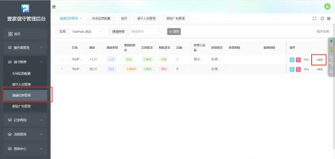

#### 呼叫效果图如下：
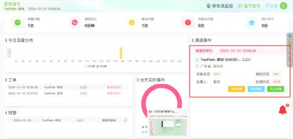

#### 壹家值守小程序端也可以接收到报警提醒操作步骤如下：
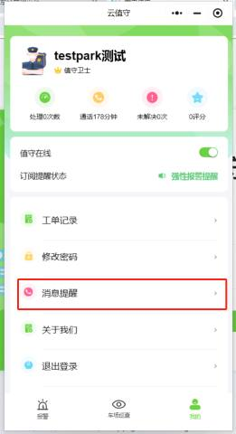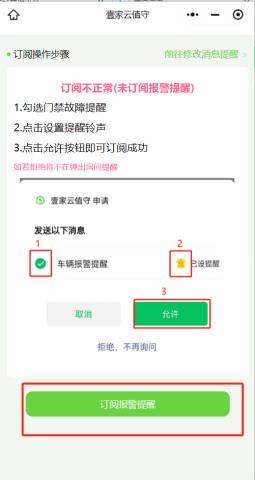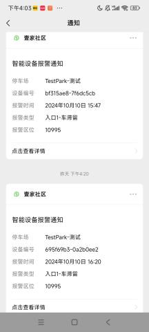

