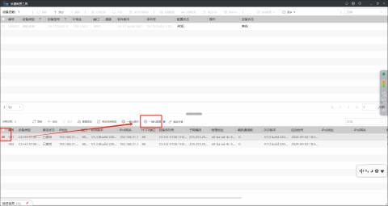
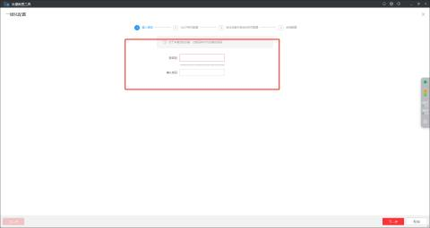
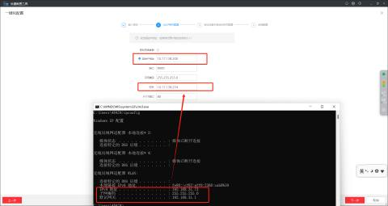
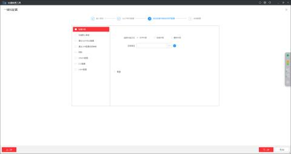
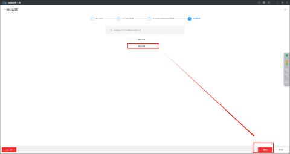
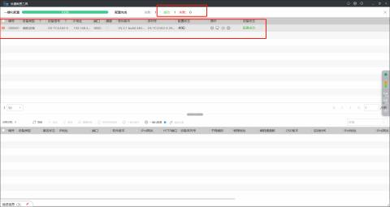
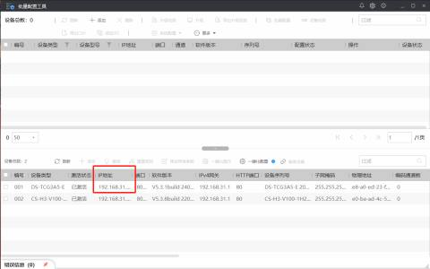
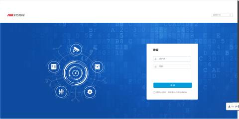
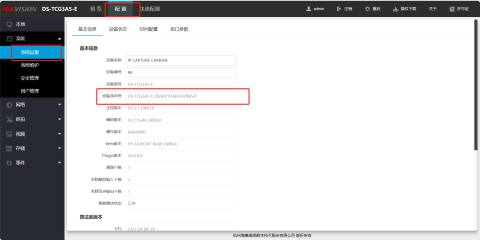
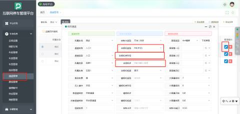

#### 注：目前海康相机只支持半云端的车场
#### 步骤一：初始化相机参数
打开海康相机搜索工具后，勾选需要连接的相机，点击“一键化配置”

注:电脑网络需和海康相机连接同一个局域网才能搜索到相机

修改相机登录密码，点击下一步

修改相机IP地址和网关成跟本地电脑同一个网段和同一个网关，点击“下一步”

到此页面不需要填写任何参数，直接点击下一步即可

配置完成后，勾选重启设备

到此页面就是初始化参数成功了。

#### 步骤二：打开海康相机搜索工具，获取IP地址

#### 步骤三：在浏览器访问输入IP地址，输入账号和密码进入海康相机的设置页面获取设备序列号
注：出厂设置默认账号密码是admin

#### 步骤四：打开停车管理平台将相机参数填入通道

| 1 | 相机类型 | 选择“HK半云” |
| --- | --- | --- |
| 2 | 主相机序列号 | 从海康相机设置页面获取 |
| 3 | 主相机IP | 在海康相机搜索工具获取 |

