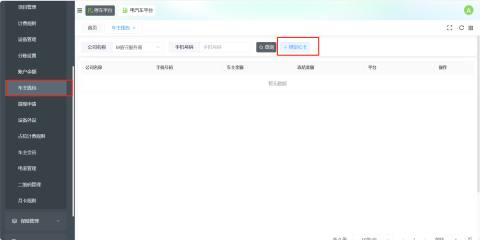
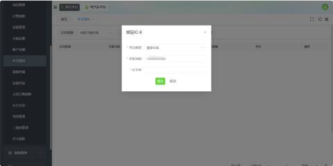
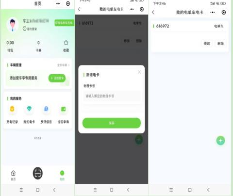

### 要实现电动单车刷卡功能可通过在充电平台或者小程序端（壹家社区）绑定IC卡实现这个功能。
### 在充电平台绑定IC卡具体操作如下：
#### 步骤一:进入充电后台：项目管理--车主钱包，绑定IC卡，如图

#### 步骤二：选择平台类型填写手机号会出现IC 卡号，如图(注：手机号必须为已注册)

| 1 | 平台类型 | 选择壹家社区 |
| :---: | :---: | :--- |
| 2 | 手机号码 | 是用户在壹家社区登录的手机号码 |
| 3 | IC卡号 | 可从物理卡获取 |

### 在壹家社区小程序端绑定IC卡具体操作如下：
#### 登录壹家社区-->我的-->我的电卡-->新增电卡--填写IC卡的物理卡号

