#### 车位锁是针对路面停车或现场没有车牌识别一体机的情况下车辆停车缴费和充电缴费而需要用到的一种设备，本文档将详细介绍车位锁各种常用操作和应用场景。
注：车位锁需要安装RF相机才能进行车牌识别

注：地锁出厂时会进行锁操控测试和平台连接，现场只需要进行安装。

#### **场景一：默认升锁地锁流程（有****RF相机）**
**系统配置**：需配备RF相机。

**车辆入场**：

· RF相机识别到新能源车辆入场时，平台下发降锁指令。

· 地锁根据等待入场时间进行等待。

· 地锁感应到锁上有车辆时不进行升锁；若感应到无车，则在等待时间结束后进行升锁。

**车辆离场**：

· 平台下发升锁指令进行升锁。

**无网络情况下**：

· 可使用RF相机对锁进行升降控制。

#### **场景二：默认降锁地锁流程（无****RF相机）**
**地锁默认处于降锁状态**：

· 当地锁感应器感应到车辆时，根据免费时间进行等待。

· 若在等待时间结束后仍有车辆，则地锁进行升锁。

· 车辆离场时，用户通过车位二维码扫码支付，支付完成后地锁下降。

#### RF相机添加流程如下：
外设管理-->添加外设

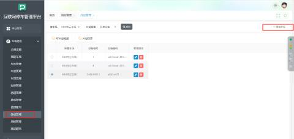

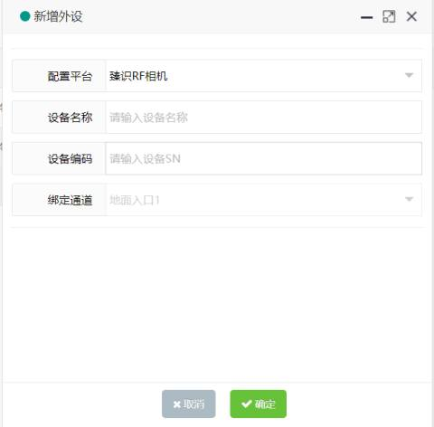

| 1 | 配置平台 | 选择臻识RF相机 |
| --- | --- | --- |
| 2 | 设备名称 | 用户可根据现场情况填写 |
| 3 | 设备编码 | 从RF相机获取 |
| 4 | 绑定通道 | RF相机需要在哪个通道使用就绑定哪个通道 |

#### 操作一：添加车位锁
##### 地锁管理-->添加地锁
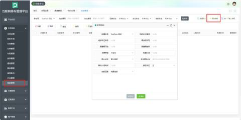

| 1 | 所属车场 | 默认当前车场 |
| --- | --- | --- |
| 2 | 地锁车位名称 | 由用户根据现场情况填写 |
| 3 | 高峰期开始 | 由用户根据现场情况填写 锁使用在充电项目时，可配置充电高峰期，锁处于高峰期时不会升锁，为长降锁模式。 |
| 4 | 车辆类型 | 由用户根据现场情况选择 停在锁上车辆的计费车型，无RF相机地锁进出记录为虚拟车牌，有RF相机地锁为实际车牌。 |
| 5 | 默认状态 | 由用户根据现场情况选择 1. 默认降锁，车辆停入后过免费时间会进行升锁。 2. 默认升锁，RF相机识别到新能源车辆入场时会进行降锁，其余时间为升锁状态。 |
| 6 | 等待入场时间 | 由用户根据现场情况填写 RF相机识别到新能源车辆入场时，平台下发降锁，在等待时间内不会升锁，过等待时间车辆未停入车位会进行升锁。 |
| 7 | 地锁品牌 | 由用户根据实际情况填写 目前支持鸿福和红门的地锁 |
| 8 | 地锁车位编号 | 用户根据实际情况填写 最好字母开头，因为这个会用来做虚拟车牌 |
| 9 | 硬件序列号 | 用户可根据实际情况填写 购买车位锁后会得到一份车位锁使用说明文档，在车位锁使用说明文档获取硬件序列号 |
| 10 | 高峰期结束 | 由用户根据现场情况填写 锁使用在充电项目时，可配置充电高峰期结束时间，当到达高峰期结束时间车位锁就会开启长升锁模式 |
| 11 | 免费时间 | 用户可根据现场情况进行设置 车位锁的一个免费时间，当到达免费时间时，车位锁会进行计费 |
| 12 | 车位相机SN | 填写车位RF相机序列号 |
| 13 | 绑定车位 | 可选：左/右 |

#### 操作二：批量导入
##### 当有多个车位锁需要添加是可选择批量导入，操作如下:
#### 步骤一：批量导入-->模版下载
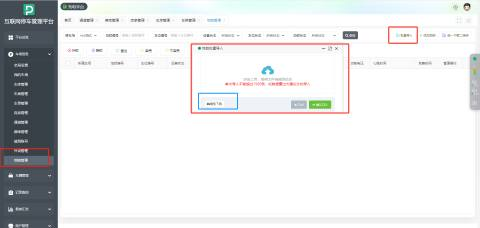

#### 步骤二：把需要录入的车位锁信息填入下载的模版中：

注：车位锁没有RF时，模板里的“车辆类型”要填不区分，如果有RF相机就要区分车辆类型

#### 步骤三：上传填好的导入模板点击确认导入
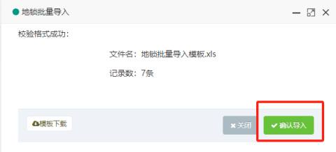

#### 步骤四：点击确认导入后会出现导入成功的提示，再点击确定就可以看到刚刚导入成功的车位锁信息
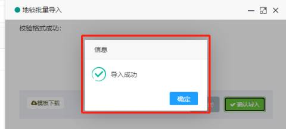

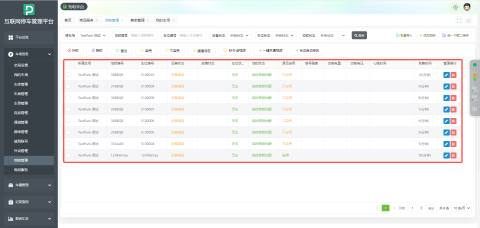

### 常用操作按钮介绍:
#### **升锁**： 地锁在降锁状态时，可下发。
#### **降锁**：地锁在升锁状态时，可下发。
#### **复位**： 一般用于新安装的地锁或地锁信息上报错误时。
启用：地锁接入系统流程，由系统控制地锁的升降

不启用：地锁不接入系统流程，可由用户自行操作地锁的升降

#### **阈值设定**：当锁上报的信息中，4G信号、电池电量、电压低于阈值时，会进行公众号推送。
#### 状态自动修改：针对车位锁现状阈值低于平台阈值设定时，需要启用车位锁的情况，可通过该按钮开启平台手动修改车位锁状态
允许：点击允许后，页面的启用和不启用按钮才能生效

不允许：点击不允许时，页面的启用和不启用按钮不会生效

#### 操作三：微信公众号消息推送
1. **新建消息接收人**：  
在“消息接收人”页面，寻找并点击“新建消息接收人”按钮（或类似命名的按钮），以便为新的接收者创建一个配置项。

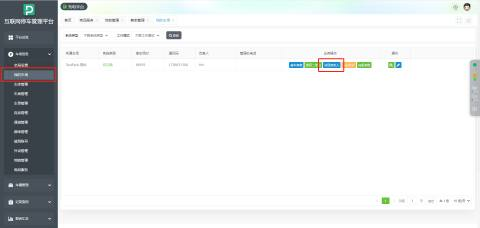

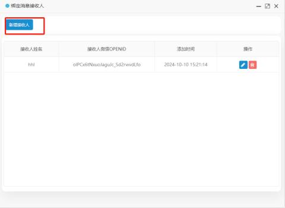

注：也可以在原有的信息接收人“**设备状态通知（地锁）**”，并且无需再扫码绑定。如下图

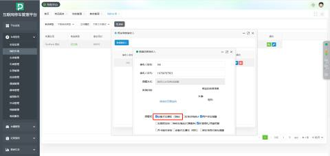

2. **勾选“设备状态通知（地锁）”**：  
在新建接收人界面，您会看到一系列可配置的选项。找到“**设备状态通知（地锁）**”选项，并勾选它。这意味着您希望为与车辆相关的通知设置此接收人。
3. **微信扫码绑定**：  
接下来，系统会提供一个二维码。使用您想接收通知的微信账号扫描此二维码。这一步是将车场平台与您的微信个人账号关联起来的关键步骤，确保通知能准确送达。
4. **保存设置**：  
完成微信扫码绑定后，不要忘记点击“确定”按钮，以确保所有设置被正确记录并生效。

我的车场-->消息接收人--设备状态通知（地锁）

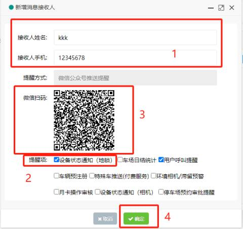

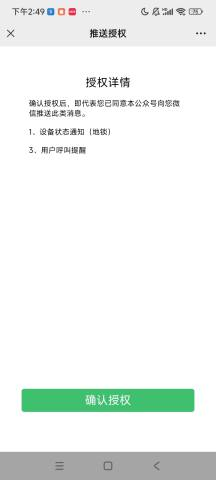

#### 微信消息推送效果图
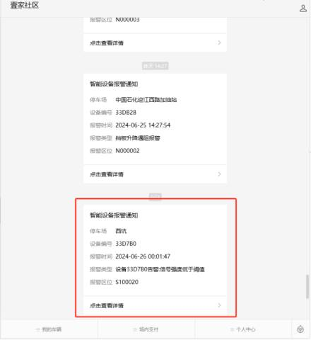

#### 操作四：扫码支付配置流程
**无****RF****相机**：

车辆入场时会根据车位编号生成虚拟车牌，用户微信扫码后会根据临时车型进行计费。

**有****RF****相机**：

车辆入场时会生成实际车牌记录，用户微信扫码后会根据停入车型进行计费。

#### 步骤一：设置计费规则
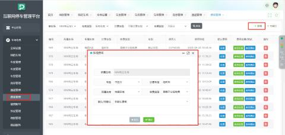

#### 步骤二：下载支付二维码
车位锁-->统一下载二维码

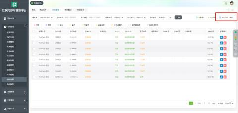

将下载的压缩包解压后即可得到支付二维码

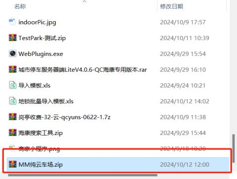

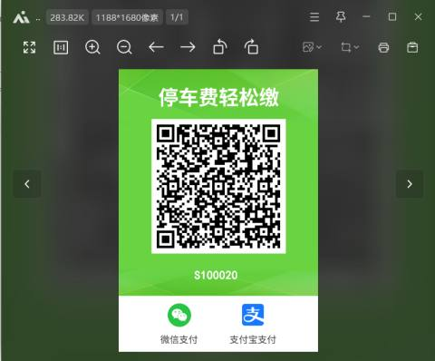

