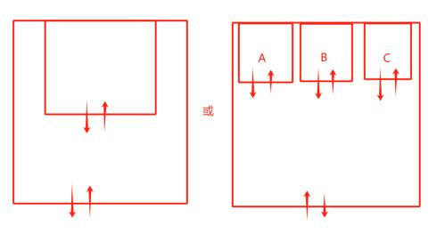
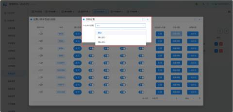

场景二：常规的大小车场或多个小车场

#### **第一步：全局基础设置**
首先，需要在系统的基本参数中定义“一户多车”的基础计费逻辑。

+ **操作路径**：【车场信息】 -> **【我的车场】** -> **【基本参数】**。
+ **关键设置**：
    - 找到 **“一户多车模式”** 选项。
    - **选择模式**：根据业务需求选择 **“切换身份模式”** 或 **“不切换身份模式”**（具体区别见上文表格）。
    - **提示**：此设置决定了A车出场后，B车的计费状态（停止计费 vs 继续计费）。

| 1 | 一户多车模式 | 默认为不开启 |
| --- | --- | --- |
| 2 | 切换计费 | 例:一个车位两台车，当A车入场时为固定车，B车入场时按临时车计费，当A车出场后，B车停止计费，B车出场时只计算B车入场的时间至A车出场时间的费用; |
| 3 | 不切换计费 | 例:一个车位两台车，当A车入场时为固定车，B车入场时按临时车计费，当A车出场后，B车继续计费B车出场时计算B车入场的时间至B车出场时间的整段费用; |

#### **第二步：车类车库绑定**
确保对应的车类（如月租车、临时车）有权限进入指定的车库。

+ **操作路径**：【车场信息】 -> **【车类管理】** -> 编辑对应的车类。
+ **配置说明**：
    - 找到 **“可停放车库”** 选项。
    - **勾选**：选择该车类允许进入的车库（例如：勾选“车库1”、“东门-道闸”）。
    - **不限制**：如果希望该车类全车场通用，可选择 **“不限车库”**。

| 1 | 可停放的车库 | 选择该车类对应可停放的车库，如不限制停放车库可选择不限车库 例:上图固定车车类勾选了车库1和3444车库那么该车类即可停放已勾选的车库; |
| --- | --- | --- |

#### **第三步：通道权限精细化配置（核心）**
这是“场景二”的核心步骤，针对具体通道设置“一位多车”的放行策略。

+ **操作路径**：【车场信息】 -> **【通道管理】** -> **【通行权限】** -> **【一位多车设置】**。
+ **配置流程**：
    1. 在列表中找到需要设置的通道（如“入口1”）。
    2. 点击 **“一位多车设置”**（通常在操作列的下拉菜单或弹窗中）。
    3. **按车类设置**：针对不同的车类（如临时车、月租车），选择对应的策略：
        * **临时车**：可设置为“确认放行”（需保安确认）。
        * **月租车**：通常设置为“默认”（自动放行）。
    4. **保存**：确认设置并保存。

| 1 | 默认 | 即当A车入场之后，B车按临时或设置了对应车类收费规则计费;当A车出场后B车是否停止计费根据步骤设置一的参数而定 |
| --- | --- | --- |
| 2 | 确认放行 | 即当A车入场之后，B车入场时需要岗享端操作是否放行，如确认放行那么B车按临时车或设置了对应车类收费规则计费;当A车出场后B车是否停止计费根据步骤一设置的参数而定 |
| 3 | 禁止放行 | 即当A车入场之后，B车入场时需要岗亭端操作是否放行，如确认放行那么B车按临时车或设置了对应车类收费规则计费;当A车出场后B车是否停止计费根据步骤一设置的参数而定 |

